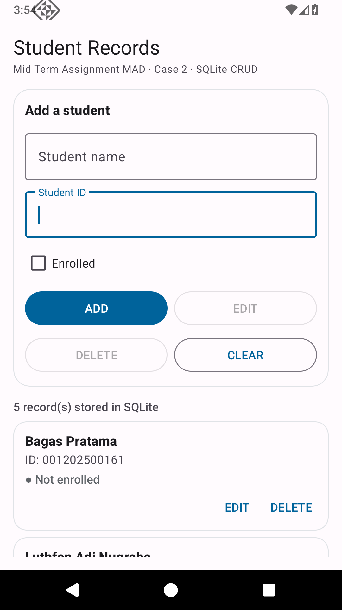

# Mid Term Assignment MAD — Student Records (SQLite CRUD)

Android application for the **Mid Examination IT 2025 – Class 2**, Mobile Application Development.
Student ID ends with an **even** digit (8), so this project answers **Case 2**.

| | |
|---|---|
| Name | Rafsanjani Castro Satria Chandra |
| Student ID | 001202500158 |
| Case | **Case 2 — Student Name, Student ID, Enrolled or not** |
| Package | `com.oswaldvalois.madmidterm` |



## What the app does

A single-screen Android app that stores student records in a local **SQLite** database
(`SQLiteOpenHelper`) and supports all four operations:

* **ADD** — insert a new student (name, student ID, enrolled flag)
* **EDIT** — tap any card, change the values, press EDIT
* **DELETE** — tap any card, press DELETE, confirm in the dialog
* **VIEW** — the list below the form shows every stored record with its enrolled status

Extra behaviour:

* Input validation — empty name / student ID are rejected with an inline error.
* The student ID column is `UNIQUE`, and the app checks it before inserting or updating,
  so the same ID cannot be saved twice.
* The selected record is highlighted with a thicker card border, and the form title
  switches between *Add a student* and *Edit selected student*.
* EDIT and DELETE are disabled until a record is selected, so the app can never act on
  "nothing".
* Snackbar feedback for every successful operation.
* Light + dark theme, edge-to-edge layout with proper system bar insets (Android 15+).

## Tech stack

| Item | Version |
|---|---|
| Language | Java 17 |
| Android Gradle Plugin | 9.3.2 |
| Gradle | 9.5.0 |
| compileSdk / targetSdk | 37 |
| minSdk | 24 (Android 7.0) |
| Storage | SQLite via `SQLiteOpenHelper` (no Room, no ORM) |
| UI | XML layouts, Material 3 components, RecyclerView |

## Database schema

```sql
CREATE TABLE students (
    _id        INTEGER PRIMARY KEY AUTOINCREMENT,
    name       TEXT    NOT NULL,
    student_id TEXT    NOT NULL UNIQUE,
    enrolled   INTEGER NOT NULL DEFAULT 0   -- 1 = enrolled, 0 = not enrolled
);
```

Database file: `student_record.db`, created on first launch by `StudentDbHelper`.

## Project structure

```
app/src/main/java/com/oswaldvalois/madmidterm/
├── MainActivity.java      // form, validation, ADD / EDIT / DELETE flow
├── StudentAdapter.java    // RecyclerView adapter + row actions
├── Student.java           // data model
└── StudentDbHelper.java   // SQLiteOpenHelper: CREATE, INSERT, UPDATE, DELETE, READ

app/src/main/res/
├── layout/activity_main.xml   // form card + record list
├── layout/item_student.xml    // one record card
├── values/ + values-night/    // strings, colors, theme, dimens
└── xml/                       // backup rules
```

## How to build and run

Open the project folder in **Android Studio** and press *Run*, or from a terminal:

```bash
git clone https://github.com/oswaldvalois/Mid-Term-Assignment-MAD-Rafsanjani-Castro.git
cd Mid-Term-Assignment-MAD-Rafsanjani-Castro

# point Gradle at your SDK
echo "sdk.dir=$HOME/Android/Sdk" > local.properties

./gradlew assembleDebug        # APK -> app/build/outputs/apk/debug/app-debug.apk
./gradlew installDebug         # install on a connected device / emulator
```

## How it was verified

Tested on an Android 15 emulator (API 36) with real UI interaction, not only compiled:

* add three students → list shows all three with the correct enrolled status
* duplicate student ID → rejected, row count unchanged
* tap a card → form loads the record, EDIT/DELETE become enabled
* change name + enrolled flag → EDIT updates the row
* DELETE → confirmation dialog, then the row is gone
* close and reopen the app → the records are still there (persisted in SQLite)

## Author

Rafsanjani Castro Satria Chandra — 001202500158
Mid Term Assignment, Mobile Application Development.